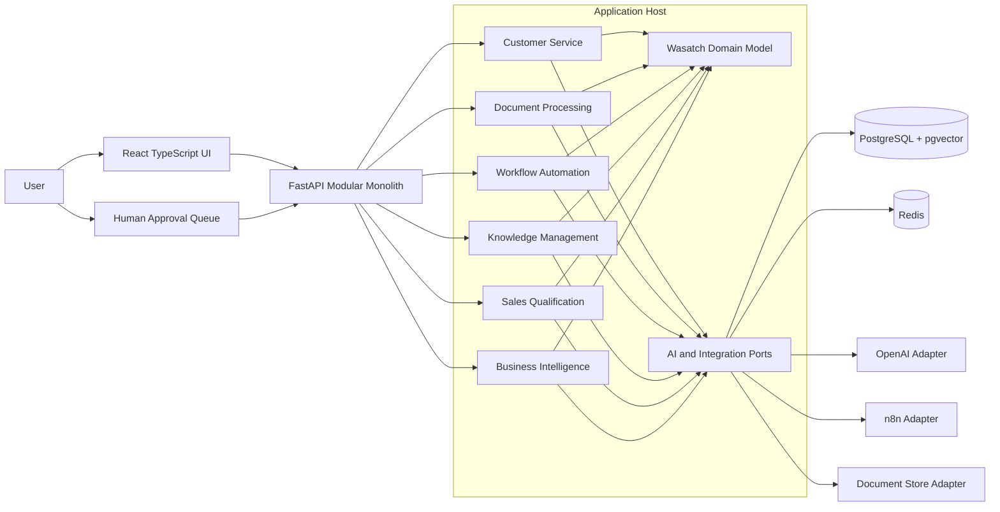

# Architecture

This document describes the **target** architecture for AI Solutions Lab. It is not a description of a running system. No application services, databases, or cloud environments have been implemented.

## Initial System Architecture

The first deployable system will be a modular monolith:

- A React + TypeScript presentation layer
- A Python + FastAPI application host
- PostgreSQL with pgvector for relational data and embeddings
- Redis for cache and short-lived coordination
- n8n for workflow automation at the edges
- OpenAI as the first AI provider, reached only through an application port
- OpenTelemetry for traces, metrics, and logs
- Docker Compose for local dependencies
- Azure and Terraform for later cloud environments

The named modules are planned boundaries, not existing packages.

## Architectural Principles

- **Domain-Driven Design where appropriate.** Use Wasatch Business Systems language for customers, work orders, technicians, invoices, and dispatch. Do not force tactical DDD patterns onto simple CRUD.
- **Hexagonal architecture.** Domain and application code depend on ports. Adapters implement those ports for PostgreSQL, Redis, OpenAI, n8n, and future systems.
- **Separated concerns.** Presentation, application use cases, domain rules, and infrastructure remain distinct.
- **Modular monolith.** Modules are explicit. The first deployment is one process, not a set of independently deployed services.
- **API-first integration.** Contracts are defined before adapters proliferate.
- **AI provider abstraction.** Prompts, tools, and embeddings are application concerns. Vendor SDKs stay in infrastructure adapters.
- **Replaceable external integrations.** Accounting, email, field-service, and storage systems are assumed to change.
- **Human approval.** Financial postings, customer-visible messages, schedule changes with field impact, and similar actions require an approval record.
- **Security, observability, and testing first.** Authorization, audit trails, telemetry, and automated tests are part of the design, not a later overlay.

## Application Boundaries

| Planned module | Responsibility |
|---|---|
| Customer service | Inbound inquiry handling, suggested replies, escalation |
| Document processing | Ingestion, classification, extraction, and review of invoices, work orders, and contracts |
| Workflow automation | Orchestration of multi-step operations, often via n8n plus in-process use cases |
| Knowledge management | Retrieval over synthetic policies, procedures, and equipment notes |
| Sales and lead qualification | Lead scoring, suggested follow-up, quote assistance |
| Business intelligence | Operational reporting and narrative summaries |

Shared kernels, if any, belong in `libs/` only after duplication becomes real. Frontend applications belong in `apps/`. Backend modules belong in `services/` or inside a single application package once implementation starts. Until then those directories remain reserved.

### Monorepo tooling

Nx is **not** installed. The repository has no applications or shared build graph that would benefit from it. Revisit Nx when multiple apps and libraries need coordinated builds, generators, or task caching. Record that decision in an ADR if the choice changes.

Specialized services in Java, Scala, or Rust are allowed only with a written justification. They are not part of the initial host.

## AI Provider Abstraction Strategy

The application layer will define ports for:

- Chat completion and tool use
- Embeddings
- Moderation or safety checks when required

OpenAI is the first adapter. Domain objects must not import OpenAI clients, model names as business rules, or prompt strings scattered across modules. Model selection, retries, and token accounting belong in infrastructure or a dedicated AI application service.

This keeps the laboratory able to compare providers later without rewriting Wasatch use cases.

## Data Architecture

| Concern | Proposed store |
|---|---|
| Operational records | PostgreSQL |
| Embeddings and similarity search | pgvector in the same PostgreSQL instance |
| Cache, rate-limit counters, short-lived locks | Redis |
| Source documents | Object storage behind an adapter; local filesystem is acceptable in development |
| Workflow state owned by n8n | n8n's own store, with business-of-record state remaining in PostgreSQL |

All laboratory records are synthetic. Production-like schemas should still assume that customer, employee, and financial data are sensitive.

## Integration Strategy

- Prefer stable HTTP APIs and documented events over hidden database sharing.
- Use n8n for visual, replaceable automations such as email intake or approval notifications.
- Keep canonical business rules in the FastAPI application, not only in n8n workflows.
- Treat every external document and model output as untrusted input until validated.
- Design adapters so a real SMB's accounting or field-service system can replace the laboratory stand-in.

## Security Model

- Secrets stay in environment variables locally and in a managed secret store on Azure.
- Authentication and least-privilege authorization will be required before any module exposes customer or employee data.
- Consequential actions persist an audit event: actor, action, subject, rationale, and approval state.
- Prompt injection, document injection, and unsafe tool calls are expected failure modes. See [SECURITY.md](SECURITY.md).

## Deployment Strategy

| Environment | Strategy | Status |
|---|---|---|
| Local | Docker Compose for PostgreSQL, Redis, and later n8n; app processes on the host or in Compose | Not implemented |
| Continuous integration | GitHub Actions for formatting, linting, and repository conventions | Workflow added; no cloud credentials required |
| Cloud | Microsoft Azure, provisioned with Terraform | Not deployed |

Do not introduce Kubernetes or additional runtime clusters unless an ADR records a requirement that the modular monolith cannot meet.

## Related Documents

- [PROJECT_CHARTER.md](PROJECT_CHARTER.md)
- [architecture/DATA_CONTRACTS.md](architecture/DATA_CONTRACTS.md)
- [business/WASATCH_DOMAIN_MODEL.md](business/WASATCH_DOMAIN_MODEL.md)
- [ROADMAP.md](ROADMAP.md)
- [adr/README.md](adr/README.md)
- [adr/0001-modular-monolith-architecture.md](adr/0001-modular-monolith-architecture.md)
- [adr/0002-python-fastapi-backend.md](adr/0002-python-fastapi-backend.md)
- [adr/0003-postgresql-pgvector.md](adr/0003-postgresql-pgvector.md)
- [adr/0004-openai-provider-abstraction.md](adr/0004-openai-provider-abstraction.md)
- [adr/0005-docker-compose-local-development.md](adr/0005-docker-compose-local-development.md)
