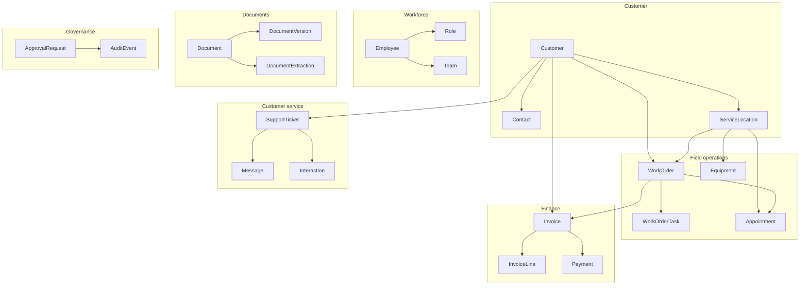
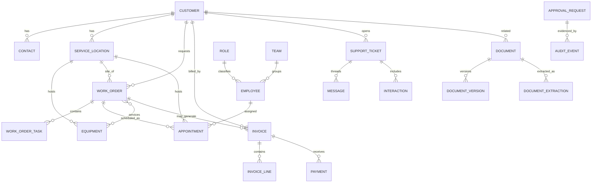

# Wasatch Business Systems Domain Model

**All information in this document is synthetic.** Wasatch Business Systems is a fictional company. Identifiers, people, customers, and financial figures do not refer to real entities.

This document defines the laboratory business language for later application services. It is independent of PostgreSQL, FastAPI, and any AI provider. JSON Schema contracts live in `data/schemas/v1/`. Valid fixtures live in `data/fixtures/valid/`.

The fixtures are a **slice** of the company described in [WASATCH_BUSINESS_PROFILE.md](WASATCH_BUSINESS_PROFILE.md): 15 of approximately 450 customers and 15 of approximately 65 employees. The model is sized for the full company; the sample is sized for reviewable laboratory work.

## Conventions

| Topic | Rule |
|---|---|
| Identifiers | `{prefix}_{nnnn}` with a four-digit sequence, for example `cust_0001` |
| Timestamps | UTC ISO 8601 with a `Z` suffix: `2026-06-15T14:30:00Z` |
| Calendar dates | ISO 8601 date: `2026-06-15` |
| Money | Object `{ "amount": "1250.00", "currency": "USD" }` with a two-decimal string |
| Phone numbers | Fictional NANP numbers using exchange `555` and subscriber `0100`–`0199` |
| Email domains | Reserved `.test` TLD |
| Unexpected properties | Rejected by schema (`additionalProperties: false`) unless a field is an open map |
| Dataset clock | Valid fixtures are interpreted as of `2026-11-03` |

## Domain Boundaries and Ownership

These boundaries match the planned modular monolith. Shared customer records are a kernel used by several modules; they are not a separately deployed service.

| Domain | Owner | Entities |
|---|---|---|
| Customer | Shared kernel used by sales, customer service, field operations, and finance | Customer, Contact, ServiceLocation |
| Workforce | Human resources, with operational use by dispatch | Employee, Role, Team |
| Field operations | Dispatch and field operations | WorkOrder, WorkOrderTask, Appointment, Equipment |
| Finance | Accounting and finance | Invoice, InvoiceLine, Payment |
| Documents | Document processing | Document, DocumentVersion, DocumentExtraction |
| Customer service | Customer service | SupportTicket, Message, Interaction |
| Governance | Management; recorded by every module | ApprovalRequest, AuditEvent |

## Entity Relationship Overview

## Shared Enumerations

| Field | Values |
|---|---|
| Customer status | `active`, `inactive`, `prospect`, `suspended` |
| Customer type | `property_manager`, `commercial_owner`, `municipal`, `healthcare`, `education`, `industrial` |
| Payment terms | `due_on_receipt`, `net_15`, `net_30`, `net_45` |
| Service agreement | `none`, `seasonal`, `full_coverage` |
| Department | `field_operations`, `dispatch`, `customer_service`, `sales`, `accounting`, `human_resources`, `parts`, `management` |
| Employee status | `active`, `leave`, `terminated` |
| Work order status | `created`, `scheduled`, `assigned`, `in_progress`, `awaiting_parts`, `completed`, `invoiced`, `cancelled`, `reopened` |
| Work order priority | `low`, `normal`, `high`, `emergency` |
| Work type | `maintenance`, `repair`, `install`, `inspection`, `callback`, `after_hours` |
| Invoice status | `draft`, `issued`, `partially_paid`, `paid`, `overdue`, `voided` |
| Ticket status | `opened`, `triaged`, `assigned`, `awaiting_customer`, `resolved`, `closed`, `reopened` |
| Approval status | `pending`, `approved`, `rejected`, `executed`, `cancelled` |
| Extraction status | `pending`, `succeeded`, `failed`, `needs_review`, `accepted`, `rejected` |

Lifecycle diagrams are in [WASATCH_WORKFLOWS.md](WASATCH_WORKFLOWS.md).

## Customer Domain

### Customer

- **Purpose.** A commercial account that buys HVAC service, maintenance agreements, or project work.
- **Identifier.** `cust_nnnn`
- **Ownership.** Customer kernel.
- **Required.** `id`, `legal_name`, `account_number`, `status`, `customer_type`, `billing_address`, `payment_terms`, `service_agreement`, `created_at`, `updated_at`
- **Optional.** `trade_name`, `billing_email`, `billing_phone`, `agreement_expires_on`, `primary_contact_id`, `notes`
- **Relationships.** Has many contacts and service locations. Referenced by work orders, invoices, tickets, documents, and interactions. `primary_contact_id` must belong to this customer when present.
- **Lifecycle.** `prospect` → `active` → `suspended` or `inactive`.
- **Validation.** `account_number` is unique. Status changes do not delete locations or history.

### Contact

- **Purpose.** A named person at a customer who can request work, approve access, or receive invoices.
- **Identifier.** `con_nnnn`
- **Ownership.** Customer kernel.
- **Required.** `id`, `customer_id`, `first_name`, `last_name`, `contact_role`, `is_primary`, `status`, `created_at`, `updated_at`
- **Optional.** `title`, `email`, `phone`
- **Relationships.** Belongs to exactly one customer. May be primary contact, ticket requester, or message author.
- **Lifecycle.** `active`, `inactive`.
- **Validation.** A customer may have multiple contacts. At most one active primary contact is expected. Email and phone are optional in the schema so incomplete records can exist; quality-issue fixtures demonstrate duplicates and missing values.

### ServiceLocation

- **Purpose.** A physical site where equipment lives and technicians perform work.
- **Identifier.** `loc_nnnn`
- **Ownership.** Customer kernel.
- **Required.** `id`, `customer_id`, `name`, `address`, `site_type`, `timezone`, `status`, `created_at`, `updated_at`
- **Optional.** `access_notes`, `square_footage`
- **Relationships.** Belongs to exactly one customer. Has many equipment assets. Work orders and appointments reference one location.
- **Lifecycle.** `active`, `inactive`.
- **Validation.** The location's `customer_id` is the owner of every work order and equipment row that points at the location.

## Workforce Domain

### Role

- **Purpose.** A job classification that carries department and approval authority.
- **Identifier.** `role_nnnn`
- **Ownership.** Workforce.
- **Required.** `id`, `name`, `department`, `is_approver`, `created_at`, `updated_at`
- **Optional.** `description`
- **Relationships.** Many employees share a role.
- **Lifecycle.** Roles are reference data; they are not workflow-state entities.
- **Validation.** `is_approver` is true only for roles allowed to decide consequential actions.

### Team

- **Purpose.** An operational grouping such as a dispatch desk or a technician crew.
- **Identifier.** `team_nnnn`
- **Ownership.** Workforce.
- **Required.** `id`, `name`, `department`, `created_at`, `updated_at`
- **Optional.** `lead_employee_id`, `service_area`
- **Relationships.** Optional lead employee. Employees may belong to one team.
- **Validation.** `lead_employee_id`, when present, must reference an employee.

### Employee

- **Purpose.** A person employed by Wasatch Business Systems.
- **Identifier.** `emp_nnnn`
- **Ownership.** Workforce.
- **Required.** `id`, `employee_number`, `first_name`, `last_name`, `email`, `role_id`, `department`, `job_title`, `status`, `hire_date`, `created_at`, `updated_at`
- **Optional.** `phone`, `team_id`, `certifications`
- **Relationships.** Assigned to work orders, appointments, tickets, approvals, and audit events.
- **Lifecycle.** `active`, `leave`, `terminated`.
- **Validation.** `employee_number` is unique. `department` should match the role's department.

## Field Operations Domain

### Equipment

- **Purpose.** A maintainable asset at a service location.
- **Identifier.** `eq_nnnn`
- **Ownership.** Field operations.
- **Required.** `id`, `customer_id`, `service_location_id`, `asset_tag`, `name`, `equipment_type`, `status`, `created_at`, `updated_at`
- **Optional.** `manufacturer`, `model`, `serial_number`, `installed_on`, `warranty_expires_on`, `last_service_on`, `next_maintenance_on`, `notes`
- **Relationships.** Belongs to one location and that location's customer. Work orders may reference many assets.
- **Lifecycle.** `in_service`, `needs_repair`, `pending_install`, `retired`.
- **Validation.** `customer_id` must equal the location's `customer_id`. `asset_tag` is unique.

### WorkOrder

- **Purpose.** The operational record of requested, scheduled, or completed field work.
- **Identifier.** `wo_nnnn`
- **Ownership.** Field operations.
- **Required.** `id`, `customer_id`, `service_location_id`, `status`, `priority`, `work_type`, `summary`, `opened_at`, `created_at`, `updated_at`
- **Optional.** `description`, `support_ticket_id`, `requested_by_contact_id`, `assigned_employee_ids`, `equipment_ids`, `scheduled_for`, `completed_at`, `completion_notes`, `invoice_id`, `cancelled_reason`, `reopen_reason`
- **Relationships.** Belongs to one customer and one service location. May reference equipment, appointments, tasks, a ticket, and later an invoice.
- **Lifecycle.** See workflows. Terminal-looking states can still move: completed work may be reopened; cancelled work is not silently deleted.
- **Validation.** Location must belong to the customer. Completed and invoiced work require `completed_at` and `completion_notes`. Invoiced work requires `invoice_id`. Cancelled work requires `cancelled_reason`. Reopened work requires `reopen_reason`.

### WorkOrderTask

- **Purpose.** A checklist item inside a work order.
- **Identifier.** `wot_nnnn`
- **Ownership.** Field operations.
- **Required.** `id`, `work_order_id`, `sequence`, `description`, `status`, `created_at`, `updated_at`
- **Optional.** `assigned_employee_id`, `completed_at`, `blocked_reason`
- **Lifecycle.** `pending`, `in_progress`, `completed`, `blocked`, `cancelled`.
- **Validation.** `sequence` is unique within a work order. `blocked` requires `blocked_reason`.

### Appointment

- **Purpose.** A scheduled window for on-site work.
- **Identifier.** `appt_nnnn`
- **Ownership.** Field operations / dispatch.
- **Required.** `id`, `work_order_id`, `service_location_id`, `assigned_employee_id`, `status`, `start_at`, `end_at`, `created_at`, `updated_at`
- **Optional.** `notes`, `cancellation_reason`, `replaces_appointment_id`
- **Lifecycle.** `scheduled`, `confirmed`, `in_progress`, `completed`, `cancelled`, `no_show`, `rescheduled`.
- **Validation.** `start_at` is before `end_at`. Location should match the work order. Overlapping active appointments for one technician are a business exception, not a schema error; they are kept out of the valid fixture set.

## Finance Domain

### Invoice

- **Purpose.** A request for payment, usually generated from completed work or an agreement fee.
- **Identifier.** `inv_nnnn`
- **Ownership.** Finance.
- **Required.** `id`, `customer_id`, `status`, `subtotal`, `tax`, `adjustments`, `total`, `amount_paid`, `balance`, `created_at`, `updated_at`
- **Optional.** `work_order_id`, `issued_on`, `due_on`, `voided_on`, `void_reason`, `notes`
- **Lifecycle.** See workflows.
- **Validation.** `total.amount` equals `subtotal + tax + adjustments`. `balance` equals `total - amount_paid`. Posted payments must not exceed `total`. Status must match payment and due-date facts as of 2026-11-03. Voiding is a consequential action and should have an approval record when it occurs after issue.

### InvoiceLine

- **Purpose.** A billable row on an invoice.
- **Identifier.** `il_nnnn`
- **Ownership.** Finance.
- **Required.** `id`, `invoice_id`, `description`, `quantity`, `unit_price`, `line_total`, `line_type`, `created_at`, `updated_at`
- **Optional.** `work_order_id`
- **Validation.** `line_total` equals `quantity * unit_price` at two-decimal USD precision. Invoice totals must reconcile to the sum of lines plus tax and adjustments.

### Payment

- **Purpose.** Money applied to an invoice.
- **Identifier.** `pay_nnnn`
- **Ownership.** Finance.
- **Required.** `id`, `invoice_id`, `amount`, `method`, `status`, `received_on`, `created_at`, `updated_at`
- **Optional.** `reference`, `received_by_employee_id`, `notes`
- **Lifecycle.** `pending`, `posted`, `failed`, `reversed`.
- **Validation.** Only `posted` payments reduce `amount_paid` on the invoice. Payments do not silently exceed the remaining balance; over-application is a reconciliation exception and lives in quality-issue fixtures.

## Document Domain

### Document

- **Purpose.** An untrusted file related to a customer, location, work order, or invoice.
- **Identifier.** `doc_nnnn`
- **Ownership.** Documents.
- **Required.** `id`, `title`, `document_type`, `status`, `source`, `mime_type`, `untrusted`, `created_at`, `updated_at`
- **Optional.** `customer_id`, `service_location_id`, `work_order_id`, `invoice_id`, `current_version_id`, `uploaded_by_employee_id`, `notes`
- **Lifecycle.** `uploaded`, `awaiting_extraction`, `extracted`, `needs_review`, `reviewed`, `archived`.
- **Validation.** `untrusted` is true for email, upload, and scan sources. `current_version_id` must belong to this document.

### DocumentVersion

- **Purpose.** An immutable bytes snapshot of a document.
- **Identifier.** `dv_nnnn`
- **Ownership.** Documents.
- **Required.** `id`, `document_id`, `version_number`, `storage_path`, `checksum_sha256`, `created_at`
- **Optional.** `created_by_employee_id`, `byte_size`
- **Validation.** Version numbers increase per document. Versions are not edited in place.

### DocumentExtraction

- **Purpose.** Structured fields inferred from a specific document version, pending human review when they affect operations or finance.
- **Identifier.** `dx_nnnn`
- **Ownership.** Documents.
- **Required.** `id`, `document_id`, `document_version_id`, `status`, `extractor`, `extracted_at`, `created_at`, `updated_at`
- **Optional.** `confidence`, `extracted_fields`, `reviewed_by_employee_id`, `reviewed_at`, `review_notes`
- **Lifecycle.** `pending`, `succeeded`, `failed`, `needs_review`, `accepted`, `rejected`.
- **Validation.** `document_version_id` must belong to `document_id`. Accepted or rejected extractions require reviewer and `reviewed_at`. Model output is untrusted until accepted.

## Customer Service Domain

### SupportTicket

- **Purpose.** An inbound customer issue or request tracked by customer service.
- **Identifier.** `tkt_nnnn`
- **Ownership.** Customer service.
- **Required.** `id`, `customer_id`, `status`, `priority`, `channel`, `subject`, `opened_at`, `created_at`, `updated_at`
- **Optional.** `contact_id`, `service_location_id`, `work_order_id`, `assigned_employee_id`, `resolved_at`, `closed_at`, `related_document_ids`
- **Lifecycle.** See workflows.
- **Validation.** Customer references must agree when a location or contact is present. Closed tickets require `closed_at`.

### Message

- **Purpose.** A single inbound, outbound, or internal communication on a ticket.
- **Identifier.** `msg_nnnn`
- **Ownership.** Customer service.
- **Required.** `id`, `support_ticket_id`, `direction`, `channel`, `body`, `status`, `sent_at`, `created_at`, `updated_at`
- **Optional.** `author_employee_id`, `author_contact_id`, `requires_approval`, `approval_request_id`
- **Lifecycle.** `draft`, `pending_approval`, `sent`, `failed`, `discarded`.
- **Validation.** Outbound messages that commit the company (`requires_approval: true`) must not be `sent` without an approved request. See [SECURITY.md](../SECURITY.md).

### Interaction

- **Purpose.** A summary of a customer touch, with or without a ticket.
- **Identifier.** `ixn_nnnn`
- **Ownership.** Customer service.
- **Required.** `id`, `customer_id`, `channel`, `occurred_at`, `summary`, `employee_id`, `outcome`, `created_at`, `updated_at`
- **Optional.** `contact_id`, `support_ticket_id`, `work_order_id`
- **Outcomes.** `answered`, `voicemail`, `scheduled`, `escalated`, `no_contact`

## Governance Domain

### ApprovalRequest

- **Purpose.** A required human decision before a consequential action.
- **Identifier.** `apr_nnnn`
- **Ownership.** Governance, requested by the originating module.
- **Required.** `id`, `action_type`, `status`, `requested_by_employee_id`, `subject_type`, `subject_id`, `rationale`, `requested_at`, `decision_history`, `created_at`, `updated_at`
- **Optional.** `reviewer_employee_id`, `decision_notes`, `decided_at`, `executed_at`
- **Action types.** `send_customer_message`, `void_invoice`, `issue_invoice`, `cancel_work_order`, `change_schedule`, `export_records`, `price_override`
- **Lifecycle.** See workflows.
- **Validation.** Non-pending statuses retain `decision_history`. `executed` requires a prior `approved` decision and `executed_at`. History is append-only.

### AuditEvent

- **Purpose.** An append-only record of a significant business action.
- **Identifier.** `aud_nnnn`
- **Ownership.** Governance.
- **Required.** `id`, `occurred_at`, `actor_type`, `action`, `subject_type`, `subject_id`, `outcome`
- **Optional.** `actor_employee_id`, `approval_request_id`, `details`
- **Outcomes.** `succeeded`, `failed`, `pending`
- **Validation.** From the application's perspective audit events are insert-only. There is no `updated_at`. Future services must not update or delete these rows.

## Business Relationships

- A customer can have multiple contacts and service locations.
- A service location belongs to exactly one customer.
- A work order belongs to a customer and a service location.
- A work order may reference multiple equipment assets.
- Employees can be assigned to work orders and appointments.
- An appointment schedules work at a service location.
- Completed work orders may generate invoices.
- An invoice contains one or more invoice lines.
- Payments are associated with invoices.
- Documents can be associated with customers, locations, work orders, and invoices.
- Document extractions retain their source document and version.
- Approval requests identify the action, requester, reviewer, and outcome.
- Audit events record significant business actions.

## Invariants

Distinguish **business rules** (true of the company) from **implementation constraints** (true of these contracts and the valid fixture set).

### Business rules

- Invoice totals reconcile with lines, tax, and adjustments.
- Payments must not silently exceed the outstanding balance.
- Completed work orders include completion time and notes.
- Approval requests retain decision history.
- Audit events are append-only.
- A document extraction retains provenance to its source document and version.
- Relationships refer to existing records.
- Consequential finance and customer-facing actions require approval.
- External documents and model extractions are untrusted until reviewed.

### Implementation constraints

- Identifiers match their prefix pattern and are unique in the laboratory dataset.
- Monetary amounts are USD strings with two decimal places.
- Valid fixtures contain no dangling foreign keys.
- Quality-issue fixtures are stored separately and are not mixed into `data/fixtures/valid/`.
- JSON objects reject unknown properties except documented open maps such as `extracted_fields` and audit `details`.

## Provenance and Audit

- Documents record `source` and `untrusted`.
- Extractions record `extractor`, `document_version_id`, confidence, and review outcome.
- Messages that require approval point at `approval_request_id`.
- Audit events can point at an approval and a subject without replacing the approval history.
- Synthetic labels belong in fixture envelopes (`synthetic: true`), not as a substitute for handling the data as sensitive.

## Synthetic Data Generation

- Use readable prefixed identifiers allocated in stable numeric order.
- Prefer interconnected scenarios over isolated rows.
- Keep the valid set internally consistent.
- Put deliberate defects in `data/fixtures/quality-issues/`.
- Do not copy real Utah businesses, employees, or customers. Names, streets, and phones in this laboratory are invented.

See [../architecture/DATA_CONTRACTS.md](../architecture/DATA_CONTRACTS.md) for schema versioning and validation.
