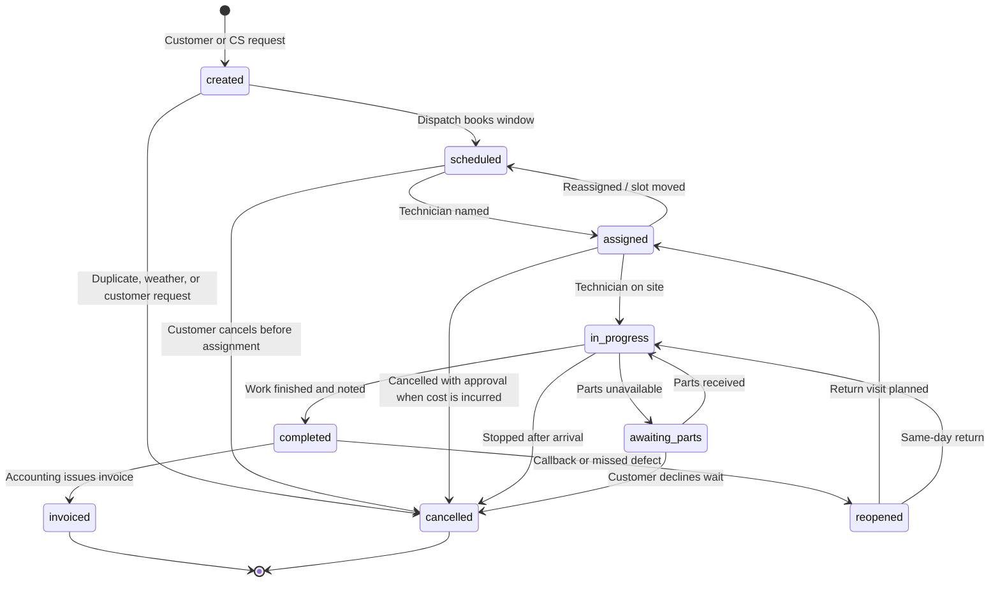
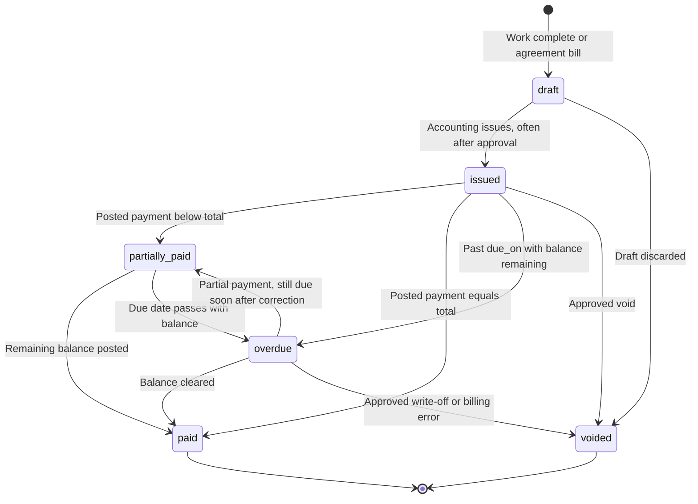
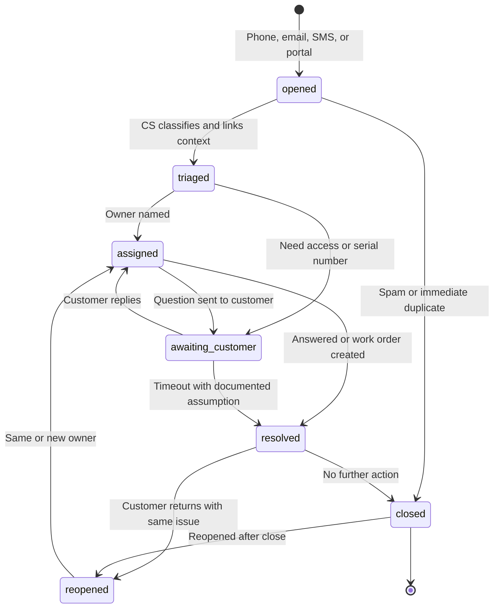
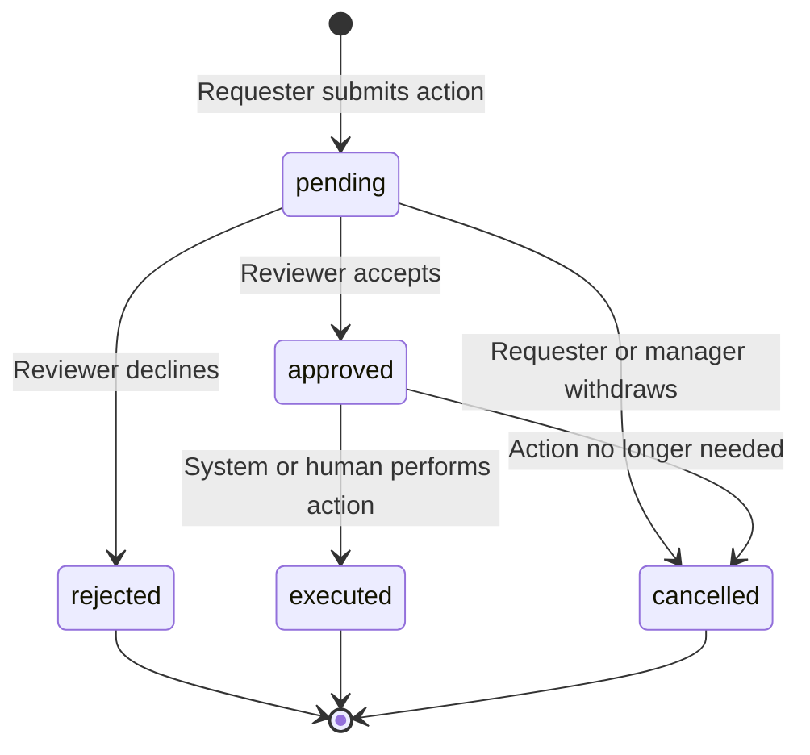

# Wasatch Business Systems Workflows

**All workflows describe synthetic laboratory processes** for Wasatch Business Systems. They are not implemented application state machines yet. Status values match [WASATCH_DOMAIN_MODEL.md](WASATCH_DOMAIN_MODEL.md) and `data/schemas/v1/`.

None of these workflows is strictly linear. Dispatch, accounting, and customer service reopen, cancel, and wait on people and parts. Human approval is required before financial postings and customer-committing messages.

Dataset clock: **2026-11-03**.

## 1. Work Order

Happy path: `created` → `scheduled` → `assigned` → `in_progress` → `completed` → `invoiced`.

Exception paths include awaiting parts, cancellation, no-show rescheduling, and reopening after completion.

### Guards and human intervention

- Moving a booked appointment that affects field cost uses `change_schedule` approval when the visit is imminent.
- `cancelled` after assignment or progress uses `cancel_work_order` approval.
- `completed` and `invoiced` require `completed_at` and `completion_notes`.
- `invoiced` requires an `invoice_id`.
- `reopened` requires `reopen_reason` and typically a callback work type or task.
- Awaiting parts is a waiting state, not a failure. The work order remains the system of record.

## 2. Invoice

Happy path: `draft` → `issued` → `partially_paid` → `paid`.

Overdue and voided are sibling states, not required steps. A draft can be discarded by voiding before issue. An issued invoice can become overdue with or without partial payment.

In the laboratory status model, `overdue` is the status whenever the invoice is past due and unpaid as of 2026-11-03, including invoices that already have a partial payment. `partially_paid` is used when a balance remains but the invoice is not yet due.

### Guards and human intervention

- Issuing a material invoice can require `issue_invoice` approval.
- Voiding an issued invoice requires `void_invoice` approval and `void_reason`.
- `total = subtotal + tax + adjustments`.
- `amount_paid` is the sum of `posted` payments only.
- `balance = total - amount_paid`.
- Posted payments must not exceed `total`. Over-application is a reconciliation case, not a silent success.
- Price overrides on lines require `price_override` approval.

## 3. Support Ticket

Happy path: `opened` → `triaged` → `assigned` → `awaiting_customer` → `resolved` → `closed`.

`awaiting_customer` is optional. Many tickets never wait on the customer. Resolved tickets can reopen. Closed is the intended rest state.

### Guards and human intervention

- Outbound messages that commit Wasatch require `send_customer_message` approval before `sent`.
- Creating field work from a ticket does not close the ticket automatically.
- `closed` requires `closed_at`. `resolved` should record `resolved_at`.
- Emergency priority tickets skip the leisurely triage wait in practice but still pass through `triaged` or `assigned` so reporting stays consistent.

## 4. Approval Request

Happy path: `pending` → `approved` → `executed`.

Rejection and cancellation are first-class outcomes. Execution is a separate step so an approval cannot be mistaken for the side effect.

### Guards and human intervention

- `decision_history` appends every transition with actor, time, from-status, to-status, and note.
- `approved` and `rejected` require `reviewer_employee_id` and `decided_at`.
- `executed` requires `executed_at` and a prior approval.
- Reviewers should hold a role with `is_approver: true`.
- Automation may create the pending request. It may not mark `executed` without a human decision for the action types listed in the domain model.

## Cross-workflow sequences

Typical emergency repair:

1. Ticket `opened` from a phone call.
2. Work order `created` with `emergency` priority.
3. Appointment scheduled; work order `assigned` then `in_progress`.
4. Ticket `resolved` when the technician is rolling, or later when the customer is informed.
5. Work order `completed` with notes, then invoice `draft` → `issued`.

Typical document-driven vendor bill:

1. Document `uploaded` from email, `untrusted: true`.
2. Extraction `needs_review`.
3. Human accepts extraction.
4. Invoice draft created; `issue_invoice` approval if amounts are unusual.

See [WASATCH_DOMAIN_MODEL.md](WASATCH_DOMAIN_MODEL.md) for invariants and [../architecture/DATA_CONTRACTS.md](../architecture/DATA_CONTRACTS.md) for machine-readable status enumerations.
